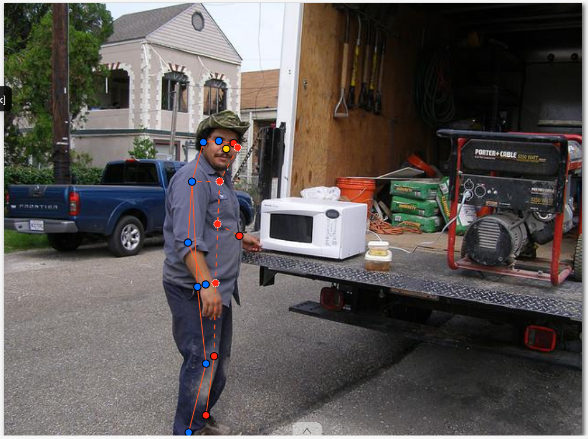
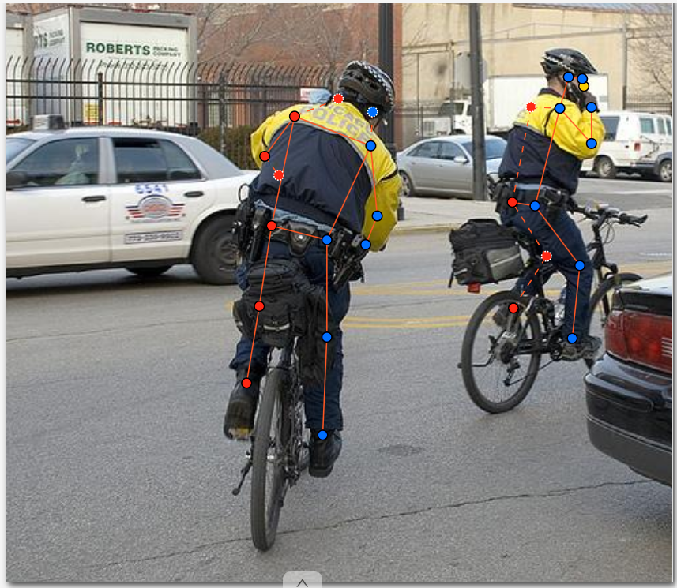
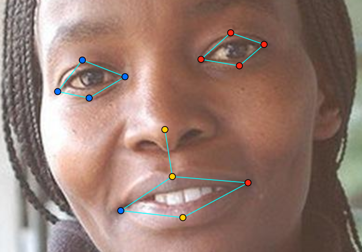
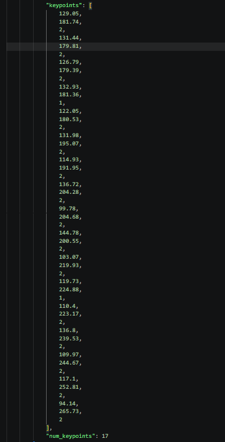

# Báo cáo cá nhân — 2A202603314_BachDangNgocTuan

Đổi tên file theo quy tắc `MSSV_HoTen.md`. Ví dụ: `20241234_NguyenVanAn.md`.

Dữ liệu: 12 ảnh người COCO val2017 (Lin et al., 2014) và 8 ảnh chân dung Wikimedia Commons, chỉ dùng trong lớp.

## 0. Thông tin học viên

- Họ tên: Bạch Đăng Ngọc Tuấn
- MSSV: 2A202603314
- Email: bachtuan2612@gmail.com
- Link repository: https://github.com/Tuan-Bach/K5-L2B-DAY04-BachDangNgocTuan-2A202603314-KeypointPose
- Phiên bản CVAT (Help → About): v2.74.1
- Máy: hệ điều hành Windows 11 (WSL2) · RAM 16 GB · chạy CVAT chế độ đầy đủ
- Bộ ảnh (`src/exports/assignment.json` do `lab.py setup` tạo): có
- Giờ bắt đầu: 18:00
- Giờ kết thúc: 21:30

## 1. Kiểm tra label (CP0)

| Label | Kiểu | Số điểm | Tên điểm đúng bảng của lab? | Đúng thứ tự? | Số cạnh |
|---|---|---:|---|---|---:|
| `person` | Skeleton | 17 | Có | Có | 19 |
| `face` | Skeleton | 13 | Có | Có | 13 |

Mẫu `person` dựng theo người quay mặt về camera (các điểm `left_*` nằm bên phải khung mẫu)? Có

Cách đổi cờ `occluded` / `outside` cho **một điểm** trên phiên bản CVAT này (một câu):

Mở rộng skeleton ở bảng **Objects** bên phải (hoặc chuột phải trực tiếp vào đúng điểm cần sửa trên ảnh) rồi bật/tắt biểu tượng **Occluded** hoặc **Outside** của riêng điểm con đó (không bấm trên skeleton cha để tránh đổi toàn bộ các điểm).

## 2. Số lượng đã gán và thời gian (CP1, CP2)

| Nhóm ảnh | Số ảnh | Số skeleton đã gán | Số người dưới 60 px (không gán) | Số poster / gương / màn hình bỏ qua | Thời gian (phút) |
|---|---:|---:|---:|---:|---:|
| `easy` | 5 | 5 | 0 | 0 | 25 |
| `occluded` | 3 | 5 | 0 | 1 | 24 |
| `back` | 2 | 4 | 1 | 1 | 18 |
| `small` | 1 | 2 | 1 | 0 | 10 |
| `crowd` | 1 | 3 | 2 | 0 | 15 |
| `faces` | 8 | 8 | — | 0 | 26 |

- Số ảnh người đã xong ở mốc phút 105: 10 / 12
- Thời gian thực tế (phút): CP1 92 · CP2 26 · CP3 18
- Ảnh tốn thời gian nhất là ảnh nào, vì sao?

Ảnh `000000309169.jpg` (nhóm crowd) và `000000297227.jpg` (nhóm back) là tốn thời gian nhất:
- Với ảnh `000000309169.jpg`: Cảnh chơi ném đĩa có nhiều người chuyển động nhanh với tư thế nhảy bắt đĩa trên không phức tạp; hai người ở tiền cảnh bị che khuất và đan xen nhau (chân tay vắt qua, áo thun xô lệch), phải zoom lớn để lần từng khớp từ vai -> khuỷu -> cổ tay và xác định đúng người sở hữu khớp để tránh gán nhầm sang người kia, đồng thời phải gắn cờ `occluded` cho các điểm bị người khác che.
- Với ảnh `000000297227.jpg`: Hai cảnh sát đi xe đạp quay lưng về camera. Phải đổi ngược toàn bộ các điểm trái/phải (`left_*` sang bên trái ảnh, `right_*` sang bên phải ảnh) theo quy tắc người quay lưng trước khi kéo khớp; phần mặt không nhìn thấy phải xác định cờ outside cho mũi, mắt và phán đoán tai, chân tay đạp xe và đồ bảo hộ (balo, súng ngắn, bộ đàm) che khuất hông và cổ tay.

## 3. Bảng ca khó (CP1, CP2)

Mỗi điểm bạn phân vân một dòng, nhất là phân vân giữa `v = 1` và `v = 0`, hoặc không chắc hướng người.

| Ảnh | Người / mặt | Điểm | Cờ đã chọn | Phân vân giữa | Lý do chọn |
|---|---|---|---:|---|---|
| `000000078170.jpg` | Người 1 (trong tàu) | `left_knee`, `right_knee`, `left_ankle`, `right_ankle` | 0 | `v = 1` và `v = 0` | Thành tàu che kín hoàn toàn từ đùi trở xuống, không có đường chân hay góc gập để suy đoán chính xác; chọn `outside` (`v = 0`) để tránh loss phạt model do đoán bừa |
| `000000179201.jpg` | Người 2 (gõ laptop) | `right_hip` | 0 | `v = 1` và `v = 0` | Bàn và chăn kotatsu trùm kín toàn bộ nửa thân dưới, hông phải hoàn toàn bị khuất sâu dưới chăn không xác định được tọa độ tin cậy nên chọn `outside` (`v = 0`) |
| `000000183176.jpg` | Người lái mô tô | `left_ankle`, `right_ankle` | 0 | `v = 1` và `v = 0` | Khung ảnh cắt ngang cẳng chân, cổ chân nằm hẳn ngoài mép dưới ảnh; theo quy tắc không kéo điểm về mép ảnh mà phải đặt `outside` (`v = 0`) |
| `000000297227.jpg` | Cảnh sát trái | `left_ear`, `right_ear` | 1 | `v = 1` và `v = 0` | Người đội mũ bảo hiểm quay lưng, tai bị quai và vành mũ che nhưng ước lượng được vị trí đối xứng hai bên đầu ngang thái dương với độ tin cậy cao nên chọn `occluded` (`v = 1`); còn mũi và mắt quay về trước không thấy nên chọn `v = 0` |
| `000000480582.jpg` | Người quấn khăn đi bộ | `left_wrist`, `right_wrist` | 0 | `v = 1` và `v = 0` | Tay buông/gập giấu bên trong ống tay áo thụng rộng và bị thân che khi nhìn từ phía sau, không rõ đặt trước bụng hay buông xuôi, độ bất định quá lớn nên chọn `outside` (`v = 0`) |
| `face_405456.jpg` | Mặt nam kính râm | 8 điểm vùng mắt (`*_eye_*`) | 1 | `v = 1` và `v = 2` | Tròng kính râm đen che kín hoàn toàn con ngươi và mí mắt; tuy nhiên khung gọng kính định hình rõ hốc mắt, theo quy ước lab trường hợp kính râm đen gán `occluded` (`v = 1`) đặt tại tâm gọng mắt ước lượng, không để `v = 2` |
| `face_137371.jpg` | Mặt nữ góc nghiêng | `left_eye_inner`, `left_eye_upper` | 2 | `v = 2` và `v = 1` | Mắt trái ở góc xa bị sống mũi che nhẹ khóe trong, nhưng hình thái mí mắt và nhãn cầu vẫn nhìn rõ nên giữ cờ thấy rõ `v = 2` |

## 4. Bảng tự review (CP3)

Đi từ ảnh cuối về ảnh đầu. 5 ảnh người (ít nhất 2 ảnh `back` hoặc `crowd`) và 3 ảnh mặt. Ít nhất 8 dòng, kể cả dòng `ok`. Ghi lỗi trước, sửa sau.

Mã lỗi dùng đúng một trong: `lr_swap`, `vis_flag`, `position`, `missing`, `extra`, `ok`.

| Ảnh | Người / mặt | Điểm | Mã lỗi | Ghi chú | Đã sửa? |
|---|---|---|---|---|---|
| `face_562485.jpg` | Mặt 1 | `lip_upper` | `position` | Ban đầu đặt hơi cao lên nhân trung, đã kéo sát mép ngoài viền môi trên | Có |
| `face_405456.jpg` | Mặt 1 | 8 điểm vùng mắt (`*_eye_*`) | `vis_flag` | Ban đầu để mặc định `v = 2`, sau khi rà soát theo guideline kính râm đen đã đổi tất cả 8 điểm sang `occluded` (`v = 1`) | Có |
| `face_137371.jpg` | Mặt 1 | Toàn bộ 13 điểm | `ok` | Mặt nghiêng nhìn sang trái, vị trí mí và khóe miệng đặt chuẩn mép | Có |
| `000000480582.jpg` | Người 1 (ông lão quay lưng) | `left_wrist`, `right_wrist` | `vis_flag` | Ban đầu để `v = 1` đoán cổ tay, nhưng tay giấu trong áo thụng không có căn cứ ước lượng chắc chắn, đã chuyển sang `outside` (`v = 0`) | Có |
| `000000309169.jpg` | Người 2 (cô gái áo đen) | `left_knee`, `right_knee` | `lr_swap` | Do tư thế chạy bắt chéo chân, ban đầu nhầm chân trái và chân phải của người, đã hoán đổi lại đúng theo hướng cơ thể | Có |
| `000000297227.jpg` | Người 1 (cảnh sát xe đạp trái) | Toàn bộ skeleton | `lr_swap` | Người quay lưng nhưng ban đầu đặt theo mẫu quay mặt (`left` bên phải ảnh), đã đổi chỗ toàn bộ các cặp `left_*` sang bên trái ảnh và `right_*` sang bên phải ảnh | Có |
| `000000179201.jpg` | Người 1 (nam áo khoác sọc) | `left_knee`, `left_ankle` | `position` | Chân nằm dưới bàn kotatsu nhưng điểm bị kéo sát về mép bàn, đã đặt lại đúng hướng cẳng chân và gắn cờ `outside` (`v = 0`) | Có |
| `000000019754.jpg` | Người 1 (cô gái trượt ván) | `left_ankle`, `right_ankle` | `vis_flag` | Ban đầu để `v = 2`, phát hiện bàn chân bị ván trượt và quai buộc che khuất, đã chuyển thành `occluded` (`v = 1`) | Có |

Tổng hợp số lỗi theo mã:

| `lr_swap` | `vis_flag` | `position` | `missing` | `extra` | `ok` |
|---:|---:|---:|---:|---:|---:|
| 2 | 3 | 2 | 0 | 0 | 1 |

Điểm còn phân vân giữa `v = 1` và `v = 0` (ghi cả hai lựa chọn và lý do chọn):

Ở ảnh `000000480582.jpg`, điểm `left_knee` và `left_ankle` của người đàn ông quấn khăn đi bộ quay lưng:
- Lựa chọn 1 (`v = 1`): Chân trái đang sải bước làm căng lớp vải áo chùng dài, có thể ước lượng khớp gối dựa trên nếp gập và chuyển động sải chân.
- Lựa chọn 2 (`v = 0`): Vải áo dài thụng che kín chân, vị trí thực tế của khớp có thể lệch so với phán đoán từ nếp vải bên ngoài.
- Lý do chọn: Quyết định chọn `v = 1` cho `left_knee` vì nếp gấp căng sát vị trí gập đầu gối khi sải bước cho phép ước lượng đủ tin cậy (3 người cùng đoán sẽ cho vị trí sát nhau). Đối với `left_ankle`, ống quần buông thụng che lấp hoàn toàn bàn chân tiếp đất nên dứt khoát chuyển sang `outside` (`v = 0`) để tránh loss phạt model do tọa độ đoán bừa.

## 5. Kiểm file xuất và kết quả tự kiểm (CP4)

Tự kiểm tay trong file JSON:

| File | Người / mặt kiểm (ảnh, thứ tự) | Số phần tử `keypoints` | Điểm `outside` ra `v = 0`, `occluded` ra `v = 1`? | `num_keypoints` khớp? |
|---|---|---:|---|---|
| `BachDangNgocTuan_persons.zip` | `000000078170.jpg` (annotation #2) | 51 | Có (`v=0`: 5, `v=1`: 8, `v=2`: 4) | Có (12 = 12) |
| `BachDangNgocTuan_persons.zip` | `000000019754.jpg` (annotation #1) | 51 | Có (`v=0`: 0, `v=1`: 5, `v=2`: 12) | Có (17 = 17) |
| `BachDangNgocTuan_faces.zip` | `face_405456.jpg` (annotation #5) | 39 | Có (`v=0`: 0, `v=1`: 8, `v=2`: 5) | Có (13 = 13) |

Sau khi xuất, CVAT ghi `occluded` thành `v = 1` và `outside` thành `v = 0`. Tọa độ của điểm `outside` trong file là `0, 0` hay tọa độ cũ? Tọa độ cũ (CVAT 2.x giữ nguyên tọa độ cũ khi đánh dấu `v = 0`).

Hai job đã chuyển sang completed trên CVAT? Có

Dán phần **TÓM TẮT** in ra từ `src/check_submission.py`:

```text
----- TÓM TẮT (dán vào báo cáo mục 5) -----
- File person: BachDangNgocTuan_persons.zip
  Số ảnh: 12 · số skeleton `person`: 19 · mỗi annotation 51 số
  Skeleton theo ảnh: 000000019754=1, 000000078170=2, 000000100510=2, 000000150500=1, 000000162046=1, 000000179201=2, 000000183176=1, 000000294329=1, 000000297227=2, 000000309169=3, 000000480582=2, 000000558066=1
  Cờ v: v=2 228 (71%) · v=1 50 (15%) · v=0 45 (14%)
  num_keypoints trung bình: 14.6
- File face: BachDangNgocTuan_faces.zip
  Số ảnh: 8 · số skeleton `face`: 8 · mỗi annotation 39 số
  Skeleton theo ảnh: face_137371=1, face_145751=1, face_168953=1, face_362568=1, face_405456=1, face_496353=1, face_505385=1, face_562485=1
  Cờ v: v=2 96 (92%) · v=1 8 (8%) · v=0 0 (0%)
  num_keypoints trung bình: 13.0
- Ghi chú: 45 điểm v = 0 vẫn mang tọa độ cũ (CVAT 2.x xuất như vậy; chuẩn COCO ghi 0, 0). Không phải lỗi: điểm v = 0 bị bỏ qua khi huấn luyện và khi chấm.
- Số [LỖI]: 0 · số [CẢNH BÁO]: 0
Kết quả: ĐẠT
```

Các `[CẢNH BÁO]` còn giữ nguyên và lý do:

Không có cảnh báo (0 `[CẢNH BÁO]`).

## 6. Ảnh chụp màn hình

1. Label `person` trong label constructor (đủ 17 điểm có tên):

   

2. Một người quay lưng đã gán, cờ đã đặt:

   

3. Một khuôn mặt đã gán 13 điểm, phóng to vùng mắt:

   

4. Một đoạn JSON xuất của một người:

   

Nguồn ảnh: COCO val2017 / Wikimedia Commons.

## 7. Tự đánh giá

1. Lỗi bạn mắc nhiều nhất hôm nay, và cách bạn sẽ tránh ở dự án thật:

   Lỗi phổ biến nhất là nhầm lẫn cờ visibility (`vis_flag`) giữa `v = 2` và `v = 1` khi các khớp bị che một phần bởi phụ kiện/trang phục (như mắt kính râm, ván trượt tuyết che bàn chân), và nhầm chiều trái/phải (`lr_swap`) ở những người quay lưng hoặc tư thế vặn xoắn phức tạp.
   Cách tránh ở dự án thật:
   - Luôn tự đặt 4 câu hỏi kiểm tra visibility trong guideline: nếu mắt không trực tiếp nhìn thấy khớp mà phải dựa vào suy luận/ngoại suy thì không bao giờ để `v = 2`, chỉ chọn `v = 1` khi có căn cứ ước lượng chắc chắn (3 người cùng đoán cho kết quả gần nhau), còn không chắc thì dứt khoát chọn `v = 0`.
   - Áp dụng quy trình review ngược (từ ảnh cuối lên ảnh đầu) để reset mắt và tư duy, tránh hiện tượng nhìn quen mắt bỏ sót lỗi.

2. Một quy tắc bạn đề xuất thêm vào guideline (kèm ảnh ví dụ nếu có):

   Khi gặp tình huống tai bị che khuất (do tóc, mũ bảo hiểm hoặc người nghiêng/quay lưng): Nếu ước lượng được vị trí đối xứng qua trục đầu dựa vào sống mũi/mắt/hộp sọ thì gán cờ `occluded` (`v = 1`), còn nếu góc khuất hoàn toàn hoặc đầu cúi/ngửa không rõ trục giải phẫu thì dứt khoát gán `outside` (`v = 0`) thay vì cố định vị tâm tai.

3. Nhãn của bạn đi vào model ở đâu? Chọn một lỗi bạn đã sửa và nói nó sẽ làm model học sai thế nào (heatmap, trọng số trong loss, hay bước lật ảnh):

   Trong hàm loss, điểm v = 0 có trọng số 0 (không tính phạt), còn v = 1 và v = 2 đều có trọng số 1. Nếu điểm không đoán được nhưng bạn để v = 1 (hoặc quên đổi khỏi v = 2), loss vẫn ép model khớp vào một tọa độ đoán bừa; ngược lại, điểm đoán chắc mà lại để v = 0 thì làm mất dữ liệu học hợp lệ. Lỗi `lr_swap` (đổi trái/phải) đặc biệt nghiêm trọng vì trong quá trình data augmentation (lật ảnh ngang random horizontal flip), model hoán đổi các cặp left/right; nếu gán sai nhãn trái/phải, bước lật ảnh sẽ dạy model nhận diện ngược các khớp giải phẫu và làm heatmap loss bị phạt cực nặng tại cả hai bên.

## 8. Khó khăn và lỗi kỹ thuật

- Thao tác trên CVAT: Khi đổi cờ `occluded` / `outside`, ban đầu dễ bấm nhầm trên skeleton cha ở bảng Objects bên phải làm toàn bộ 17 điểm bị đổi cờ đồng loạt, phải `Ctrl+Z` và mở rộng cây skeleton con để chọn đúng từng điểm riêng lẻ.
- Phím tắt CVAT: Cần lưu ý không dùng phím `H` (`hidden`) để thay cho `occluded` vì `hidden` chỉ ẩn tạm thời trên giao diện người dùng mà không lưu trạng thái `v = 1` lên server; khi xuất, điểm vẫn ra `v = 2` ở tọa độ cũ.
- Đổi trái/phải trên người quay lưng và người nhảy thể thao: Khi cơ thể vặn xoắn hoặc bắt chéo chi (như người chơi frisbee ở ảnh `000000309169.jpg` hoặc người trượt tuyết `000000294329.jpg`), việc phân biệt chân trái/phải đòi hỏi phải zoom lớn và lần đường nối xương từ hông xuống đùi, gối đến cổ chân để không bị nhầm lẫn.

## Bonus (nếu làm)

### B1 — 3 ảnh người khó thêm

| Ảnh | Số skeleton | Số người dưới 60 px | Ca khó nhất |
|---|---:|---:|---|
| | | | |
| | | | |
| | | | |

Kết quả `src/check_submission.py` cho `HoVaTen_bonus_persons.zip`:

```text
(dán ở đây)
```

### B2 — 5 ảnh khuôn mặt đen trắng / hồng ngoại

Ảnh không màu khó hơn ở điểm nào? Kính râm trên ảnh hồng ngoại có còn là `v = 1` không?

...

### B3 — Model so với nhãn của tôi (không tính điểm)

- Demo đã dùng:
- Ảnh đã thử:

1. Model có trả điểm cho khớp bị che, hay khớp ngoài ảnh không? Confidence ở các điểm đó thế nào?

   ...

2. Với người quay lưng, model có đổi trái/phải không?

   ...

3. Bộ điểm của model có giống 17 điểm COCO không?

   ...

## 9. Tài liệu tham khảo và công cụ AI đã dùng

- Tài liệu hướng dẫn của môn học: `RULES.md`, `GUIDELINE.md`, `CHECKPOINTS.md`, `SUBMISSION.md`.
- Công cụ AI (Antigravity chat): Hỗ trợ giải thích khái niệm `occluded` (`v = 1`) / `outside` (`v = 0`), thao tác đổi cờ từng điểm trên CVAT v2.74.1, giải thích output của `src/check_submission.py`, hướng dẫn lệnh Git/WSL
